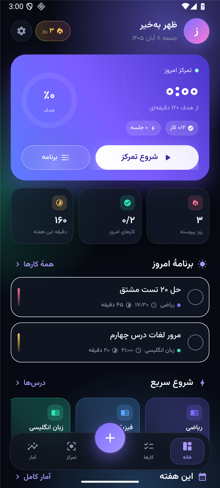
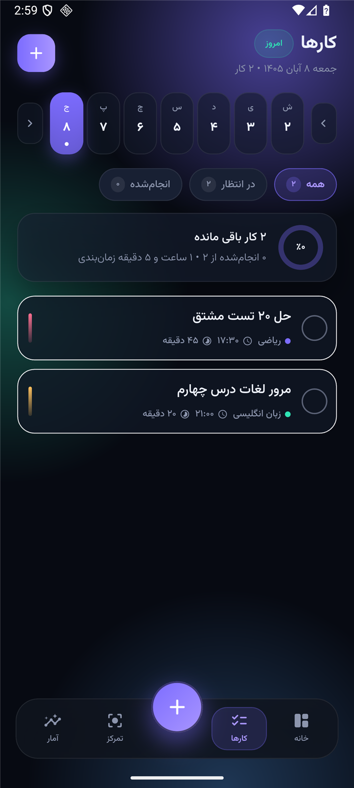
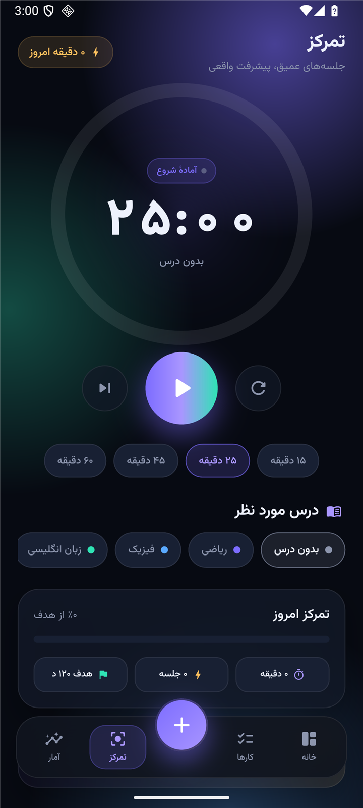
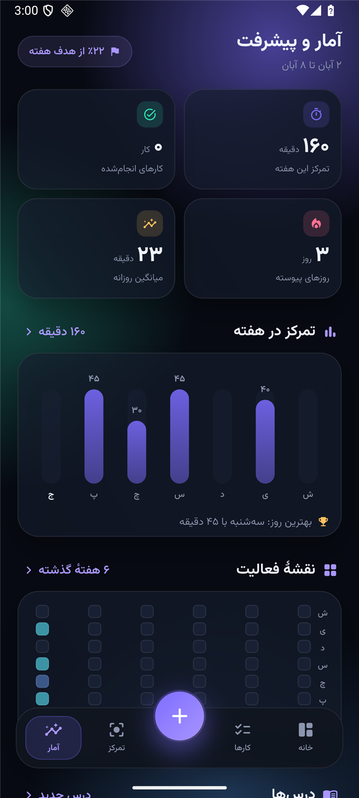

<div align="center">

# زمان‌یار · Zamanyar

**دستیار برنامه‌ریزی مطالعه و کارهای روزانه — فارسی، آفلاین، با تقویم شمسی**  
**Study planner & daily task manager for Android — Persian-first, offline, Jalali calendar**


### [⬇️ دانلود APK](https://github.com/Ekkh1300/zamanyar/releases/latest) · [Download APK](https://github.com/Ekkh1300/zamanyar/releases/latest)



</div>

---

## تصاویر · Screenshots

| خانه · Home | کارها · Tasks |
|:---:|:---:|
|  |  |
| **تمرکز · Focus** | **آمار · Stats** |
|  |  |

---

## امکانات · Features

### فارسی
- **داشبورد امروز** — حلقهٔ تمرکز روز، هدف روزانه، آمار هفته، روزهای پیوسته و برنامهٔ امروز در یک نگاه
- **مدیریت کارها** — عنوان، درس، تاریخ شمسی، ساعت شروع، مدت و تکرار؛ فیلتر همه/در انتظار/انجام‌شده و نوار هفته
- **تقویم شمسی بومی** — انتخابگر تاریخ جلالی با نمایش مناسبت روز و دکمهٔ «برو به امروز»
- **تایمر تمرکز** — پومودورو با حلقهٔ پیشرفت، انتخاب درس، توقف/ادامه و ثبت خودکار جلسه
- **آمار و بینش** — نمودار ستونی هفته، نقشهٔ فعالیت ۶ هفته، سهم درس‌ها، پیشرفت هدف هر درس، دستاوردها و رکوردها
- **درس‌ها با رنگ اختصاصی** — افزودن، ویرایش و حذف درس با رنگ و هدف هفتگی
- **ظاهر مدرن** — شیشه‌ای، تیره/روشن/سیستم، فونت وزیرمتن، اعداد فارسی، کاملاً راست‌به‌چپ
- **جشن و انگیزه** — کاغذرنگی هنگام تکمیل کارها، نوار پیوستگی و پیام‌های تشویقی
- **کاملاً آفلاین** — همهٔ داده‌ها روی خود دستگاه ذخیره می‌شوند؛ بدون حساب، بدون اینترنت

### English
- **Today dashboard** — daily focus ring, weekly stats, streak and today's plan at a glance
- **Task management** — subject, Jalali date, start time, duration and recurrence; all / pending / done filters and a week strip
- **Native Jalali calendar** — Persian date picker with day events and a "jump to today" action
- **Focus timer** — Pomodoro with progress ring, subject tagging, pause/resume and automatic session logging
- **Stats & insights** — weekly bar chart, 6-week activity heatmap, subject share donut, per-subject goals, achievements and records
- **Color-coded subjects** — add, edit and delete subjects with their own color and weekly goal
- **Modern UI** — glassmorphism, dark / light / system themes, Vazirmatn font, Persian digits, full RTL
- **Delightful feedback** — confetti on completion, streak bar and encouraging messages
- **Fully offline** — all data stays on the device; no account, no network

---

## نصب · Install

1. فایل `zamanyar-v1.0.0.apk` را از [بخش Releases](https://github.com/Ekkh1300/zamanyar/releases/latest) دانلود کنید.
2. روی گوشی اندروید ۷ به بالا (minSdk 24) نصب کنید. اجازهٔ «نصب از منابع ناشناس» لازم است.

1. Download `zamanyar-v1.0.0.apk` from [Releases](https://github.com/Ekkh1300/zamanyar/releases/latest).
2. Install on Android 7.0+ (minSdk 24). Allow "install from unknown sources" if asked.

The APK is a universal build (`arm64-v8a`, `armeabi-v7a`, `x86_64`) signed with a release key (APK Signature Scheme v2).

---

## ساخت از سورس · Build from source

```bash
flutter pub get
flutter run                  # debug on a connected device
flutter build apk --release  # universal release APK
```

Requirements: Flutter 3.47+ / Dart 3.13+, Android SDK 36, JDK 17.

If Gradle cannot download dependencies through your proxy, an offline build works once artifacts are cached:

```bash
cd android
./gradlew assembleRelease --offline --console=plain \
  -Ptarget-platform=android-arm,android-arm64,android-x64
```

### امضا · Signing

Create `android/key.properties` (git-ignored) and a keystore:

```properties
storePassword=...
keyPassword=...
keyAlias=zamanyar
storeFile=upload-keystore.jks
```

```bash
keytool -genkeypair -v -keystore android/upload-keystore.jks -keyalg RSA \
  -keysize 2048 -validity 10000 -alias zamanyar
```

Without `key.properties` the release build falls back to debug signing, so a fresh clone still builds.

---

## ساختار پروژه · Project layout

```
lib/
  core/        jalali.dart · format.dart · theme.dart
  models/      models.dart          # tasks, subjects, focus sessions
  state/       app_state.dart       # ChangeNotifier + JSON persistence
               focus_timer.dart     # Pomodoro engine
  ui/          shell.dart · home_page.dart · tasks_page.dart
               focus_page.dart · stats_page.dart
  ui/widgets/  charts.dart · task_editor.dart · jalali_picker.dart
               subjects_sheet.dart · settings_sheet.dart · glass.dart
```

State lives in `ChangeNotifier`s exposed through `InheritedNotifier` (`AppScope`, `TimerScope`) and is persisted as JSON in `shared_preferences`.

---

## حریم خصوصی · Privacy

هیچ داده‌ای از دستگاه خارج نمی‌شود؛ بدون سرور، حساب کاربری، آنالیتیکس یا تبلیغات.  
No data leaves the device: no servers, accounts, analytics or ads.

---

<div align="center">
ساخته‌شده با ❤️ برای دانش‌آموزها و دانشجوهای فارسی‌زبان · Built for Persian-speaking students
</div>
